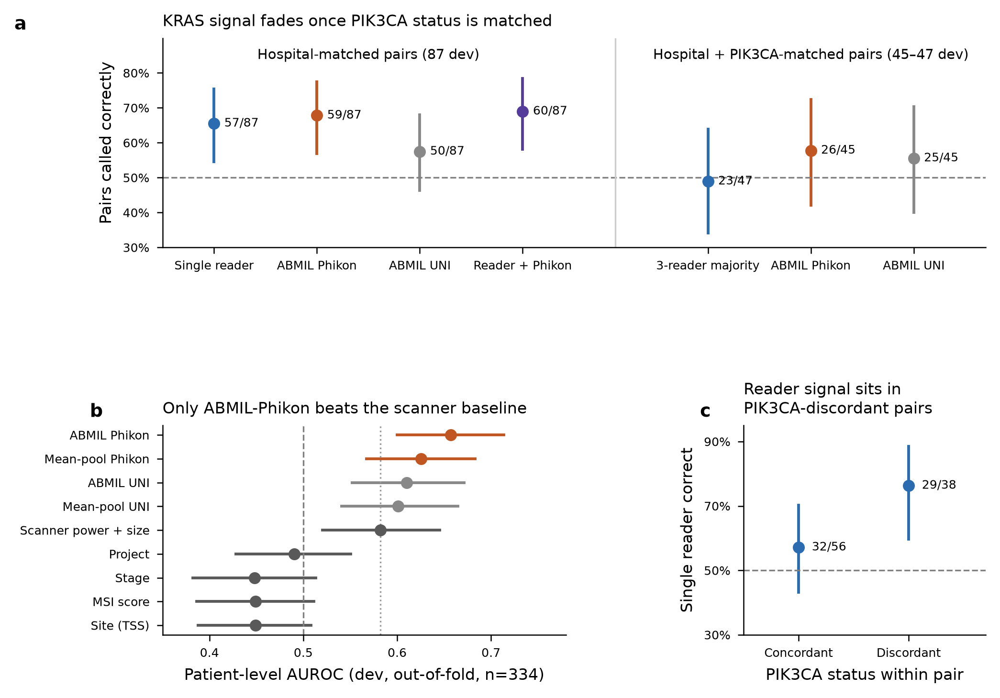

# KRAS follow-ups: three-reader PIK3CA-matched replication, slide-level model, pathologist packet

All numbers are **dev partition only** (patient_split_locked.csv). No test-partition slide was used to train, tune or score any model;
reader/grader exposure to test slides that happened earlier is logged as deviation D1 in (file not included).

## Bottom line
1. **The single-reader KRAS result did not replicate once PIK3CA was matched, even with readers primed** (deviation D4: all 189 readers were automatically shown the earlier study's morphology findings). Three independent readers per pair, primary
   endpoint pair-level majority vote: **34/63 = 54.0% (p = 0.61)**; dev-only **23/47 = 48.9%**. Per-read accuracy 109/189 = 57.7%
   (p = 0.041) is secondary, because the three reads of a pair are correlated (Fleiss κ = 0.53).
2. **The earlier signal sat almost entirely in PIK3CA-discordant pairs.** In the 116-pair study, dev-only: discordant 29/38 = 76%
   (p = 0.002) vs concordant 32/56 = 57% (p = 0.35). Readers did not simply pick the PIK3CA-mutant slide (27/46 overall), so this is
   not a clean PIK3CA detector either; KRAS + PIK3CA co-mutant tumours may carry a stronger joint phenotype.
3. **A foundation-model ABMIL sees about what the readers see.** Patient-level dev AUROC, label_kras (n = 334, 141 KRAS-mutant):
   ABMIL-Phikon **0.657** [0.600–0.714],
   ABMIL-UNI 0.610 [0.552–0.672].
   Only ABMIL-Phikon beats the best confounder baseline (paired Δ +0.075 [0.018–0.133]). Phikon was pretrained on TCGA tiles, so
   this is likely optimistic.
4. **The best confounder baseline is the scanner, not biology**: objective power + series size scores AUROC
   0.582 [0.521–0.645].
   Project, stage, MSI score and site sit at or below 0.5.

## 1. Three-reader PIK3CA-matched study
- 129 KRAS-mutant vs KRAS/BRAF-WT MSS pairs matched on project + hospital + PIK3CA status
  (../../reader_study/keys/kras3_pairs_UNBLINDED.csv); 63 had ≥15 non-overlapping tumour fields on both slides
  (../../reader_study/kras3_eligibility.csv). 15 of the 63 are PIK3CA-mutant pairs.
- Each pair was read by three readers on **mutually non-overlapping** 5-field sets (+ overviews). The prompt gave no hints, but the platform injected a project-memory summary of the earlier study (mucin and serration up in KRAS, dirty necrosis down) into every reader, so this is a primed replication (D4). A/B sealed
  (../../reader_study/keys/kras3_KEY_sealed.json). Per-read results: ../../reader_study/kras3_reader_results.csv.

| | n | correct | % | p |
|---|---|---|---|---|
| **Pair majority vote (primary)** | 63 | 34 | 54.0 | 0.61 |
| Pair majority, dev-only | 47 | 23 | 48.9 | 1.0 |
| Reader 1 / 2 / 3 | 63 each | 36 / 39 / 34 | 57 / 62 / 54 | 0.31 / 0.08 / 0.62 |
| All reads | 189 | 109 | 57.7 | 0.041 (reads not independent) |

27 pairs were called correctly by all three readers and 15 wrongly by all three: readers agree with each other (κ = 0.53, pairwise
Spearman 0.75–0.77) more than they agree with the truth. The 26 pairs shared with the 116-pair study were called the same way in
92% of cases, so the drop is not reader noise; it is the change of pair set.

## 2. Slide-level model (pre-registered protocol, dev only)
Design: label_kras primary / label_kras_sens sensitivity; primary slide only; locked TSS-grouped cv_fold 0–4; gated ABMIL with
class weighting, 3 training seeds; mean-pool logistic regression; Section 7 baselines on the same folds. Features: UNI v1 and
Phikon from one tiling pass (224 px at 0.5 µm/px, ≤4,000 tiles/slide). 349/350 dev primary slides have features
(TCGA-A6-2675 failed tissue detection). Modal cost ≈ $0.58. Scripts ../../code/train_kras_mil.py,
OOF predictions ../../results/mutation/kras_dev_oof_predictions.csv, metrics ../../results/mutation/kras_dev_metrics_auroc_calibration.csv.

| model | label_kras AUROC (all dev, 334) | excl. discovery (274) | label_kras_sens (325) | Δ vs scanner baseline |
|---|---|---|---|---|
| ABMIL Phikon | 0.657 | 0.663 | 0.693 | +0.075 [0.018, 0.133] |
| ABMIL UNI | 0.610 | 0.622 | 0.614 | +0.028 [−0.031, 0.087] |
| Mean-pool Phikon | 0.625 | 0.632 | 0.628 | +0.043 [−0.025, 0.111] |
| Mean-pool UNI | 0.601 | 0.607 | 0.611 | +0.019 [−0.058, 0.095] |
| Scanner power + series size | 0.582 | 0.575 | 0.593 | — |

Calibration: ABMIL slope 0.48–0.61, Brier 0.236–0.245; mean-pool LR is badly over-confident (slope ≈ 0.07). ABMIL early stopping
often chose epoch 0–2 (19 of 60 fits stopped at epoch 0), and per-fold ABMIL-UNI AUROC ranged 0.55–0.79: the learning signal is weak.

## 3. Readers vs model on the same pairs (87 dev pairs, both slides in the label_kras cohort)
| | correct | % |
|---|---|---|
| Single reader | 57/87 | 65.5 |
| ABMIL Phikon | 59/87 | 67.8 |
| ABMIL UNI | 50/87 | 57.5 |
| Reader + Phikon (z-sum) | 60/87 | 69.0 (p = 0.0005) |

Reader and Phikon disagree often (κ = 0.28, r = 0.33). In a conditional logistic model with the blinded grade differences,
each adds information beyond the grades and beyond the other (reader p = 0.004, Phikon p = 0.005). UNI adds nothing beyond the
reader (p = 0.27). On the 45 PIK3CA-matched dev pairs the readers used, the models also fall back: Phikon 26/45 = 58%, UNI 25/45 = 56%.
Tables: ../../reader_study/kras_reader_model_comparison_dev87.csv, ../../reader_study/kras_reader_model_grade_pairs_dev87.csv.

## 4. Pathologist spot-check packet (ready to send)
30 dev-only slides (5 test slides swapped out; 0 test or QC-excluded slides remain), 15 per arm, stratified on mucinous %,
serrated, dirty necrosis and differentiation. Packet PDF `spotcheck_packet.pdf` (see data/DOWNLOAD.md), full-resolution
fields `spotcheck_fields_fullres.zip` (see data/DOWNLOAD.md), grading sheet ../../reader_study/spotcheck_grading_sheet.xlsx,
scoring script ../../code/score_spotcheck.py. The private key is **not** to be shared with the pathologist.
Limits: item definitions are newly worded; the mutant arm has no serrated = 2 slide after the swap; one pair now contributes both slides.

## What this means for the talk
- KRAS from H&E is real but weak here (AUROC ~0.61–0.66 internally), in line with published work, and it is **entangled with
  PIK3CA co-mutation and with scanner batch**.
- The honest headline is the negative replication: under PIK3CA matching, three readers are at chance even when primed with the earlier study's features (D4).
- Next decisive check: a PIK3CA-matched or PIK3CA-adjusted model AUROC, and the same model on CPTAC-COAD (external, one look).

## Coverage limits
63 of 129 matched pairs were eligible for the three-reader study (fields per reader cut from 8 to 5 by tissue limits);
16 of those 63 contain a test-partition slide (dev-only figures given). 1 dev slide lacks features. Pre-registered encoder UNI2-h
replaced by UNI v1 (D2). LLM differentiation-grade baseline and non-primary-slide aggregation were not run.
