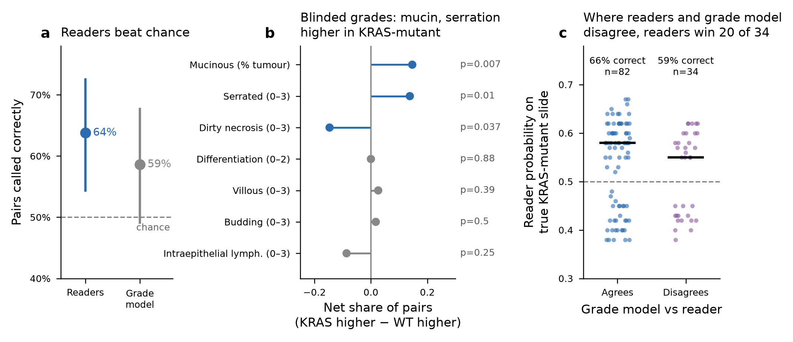

# Blinded KRAS reader study — full colorectal MSS cohort

## Bottom line
Blinded sub-agent readers, given **no hints** about KRAS morphology, picked the KRAS-mutant slide in **74/116 hospital-matched pairs
(63.8%, 95% CI 54.4%–72.5%, two-sided binomial p = 0.004)**. That sits inside the published
H&E deep-learning range for KRAS (AUROC ~0.6–0.7). The signal is **not** explained by differentiation grade — grade was balanced
between arms — and it **survives adjustment** for every blinded grade feature (likelihood-ratio p = 0.004). Readers were
uncalibrated and timid: every probability fell between 0.38 and 0.67.

## Cohort and design
- Source: ../../reader_study/keys/kras_full_pairs_UNBLINDED.csv — all TCGA COAD/READ KRAS-mutant, MSS, sequenced patients (184), 1:1 matched
  to KRAS **and** BRAF wild-type MSS controls from the **same tissue source site**, no control reused → 145 pairs
  (119 also stage-matched). Age was a tie-breaker.
- Fields: 16 candidate 517-µm fields per slide cut at 0.505 µm/px from the base level, sampled from the most haematoxylin-dense
  20% of tissue; each field then screened blind for tumour epithelium. Pairs needed ≥ 8 tumour-epithelium fields on both slides:
  **116 pairs** eligible (2 slides failed extraction; 27 pairs had too little tumour sampled). Final set: 98 stage-matched,
  33 rectal, 83 colon.
- Readers: one sub-agent per pair, 8 fields + overview per slide, slide order randomised and sealed
  (../../reader_study/keys/KEY_full.json). Told only "one is KRAS-mutant, one is wild-type, both MSS, same hospital".
- Grading: 232 slides re-coded with random IDs and graded by 8 separate sub-agents who never saw pair structure or KRAS
  status (../../reader_study/keys/grade_anon_KEY.json).

## Results

| metric | value |
|---|---|
| pairs correct | 74/116 = 63.8% (95% CI 54.4%–72.5%) |
| mean reader probability on true mutant | 0.531 (Wilcoxon vs 0.5, p = 0.0001) |
| Brier score | 0.228 (0.25 = uninformative) |
| grade-feature model, leave-one-out | 58.6% |
| grade features + reader, leave-one-out | 62.1% |
| reader term after grade adjustment | coef 2.55, p = 0.007; LRT p = 0.004 |

**Blinded grade differences (paired Wilcoxon, KRAS − WT):** mucinous component higher in KRAS (4.6% vs
1.8% of tumour, p = 0.007); serrated architecture higher (p = 0.010); dirty necrosis lower (p = 0.037).
Differentiation (p = 0.88), villous growth, budding, nuclear grade, TILs, desmoplasia and section quality did not differ.
These match the known KRAS associations (mucinous, serrated pathway) and the classic wild-type/CIN "dirty necrosis" pattern.

**Readers vs a grade model.** A conditional logistic model on the blinded grade differences calls 59% of pairs correctly.
Readers and that model agree on 82/116 pairs (66% correct); where they disagree, readers are right on 20/34 (59%; not
significant on its own, p = 0.39). Adding the reader's probability to the grade model is significant (LRT p = 0.004), so readers
are picking up something beyond the scored features — but the margin is small (LOO 59% → 62%).

**Exploratory subgroups (not pre-specified, wide intervals):**
- Colon 56/83 (67%) vs rectum 18/33 (55%).
- Pairs where readers rated both slides "good" quality: 36/53 (68%).
- Pairs discordant for PIK3CA: 33/46 (72%) vs concordant 41/70 (59%). PIK3CA is co-mutated far more in the KRAS arm
  (34.5% vs 15.5%), so part of the "KRAS" signal may be KRAS+PIK3CA.
- Codon: G12 49/75, G13 16/22, A146 1/7.
- Readers citing low-grade/poorly-differentiated features did no better than chance (52% when "poorly/solid/budding" was cited).

## Coverage limits that travel with these numbers
- 116 of 145 matched pairs (80%); 27 excluded for insufficient sampled tumour, 2 for extraction failure. Exclusion was blind to arm
  but more mutant slides fell short (33 vs 19 slides with < 4 carcinoma fields), which could bias toward easier mutant cases.
- 8 fields per slide (~2 mm² of tumour), not the whole slide.
- Most readers (72 of 103 reported deviations) viewed some fields downsampled (512–768 px) rather than at full resolution; one
  reader (pair 1) never saw 3 of 16 fields. Graders mostly scored from ~1 µm/px montages, so IEL, budding and signet-ring
  scores are lower-confidence than architecture and mucin. One grader scored its first 8 slides (S001–S008) from first-view
  impressions after the montages dropped out of its context, without re-opening them.
- 4.4% of within-slide field pairs overlap spatially.
- All readers and graders are the same model: agreement between them is not independent replication.
- One reader per pair: no inter-reader agreement estimate.

## What would strengthen this
1. Three readers per pair on disjoint fields (inter-reader κ; averaging should lift accuracy if the signal is real).
2. A pathologist grading ≥ 30 slides to calibrate the blinded grades.
3. Restrict to PIK3CA-wild-type pairs, or match on PIK3CA, to separate KRAS from co-mutation.
4. Train a slide-level model on the Phikon features already extracted on Modal and compare its AUROC to the readers' 64%.

## Files
- ../../reader_study/kras_full_reader_results.csv per-pair calls, probabilities, features cited, rationales
- ../../results/mutation/kras_full_slide_grades.csv blinded per-slide grades
- ../../reader_study/keys/eligible_pairs_UNBLINDED.csv the 116 eligible pairs (unblinded)
- ../../reader_study/field_screen.csv per-field tumour screen
- ../../code/extract_kras_full.py field extraction script
